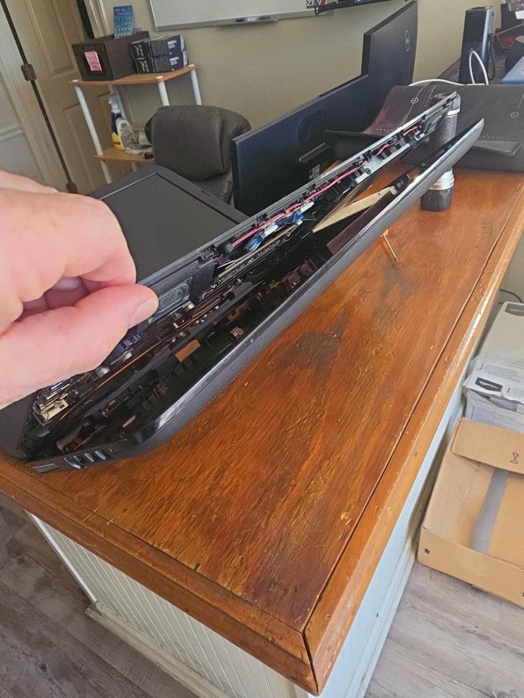
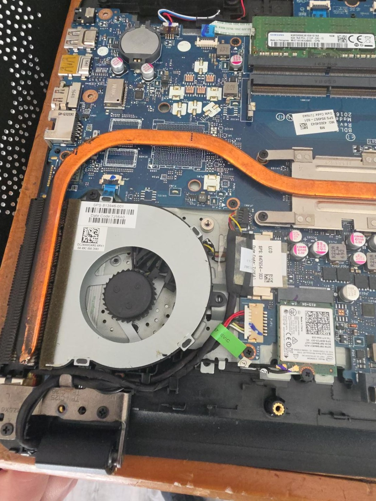
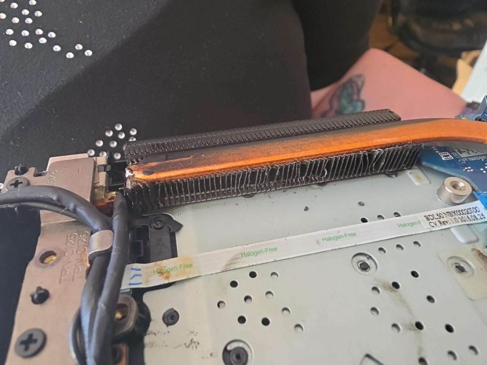
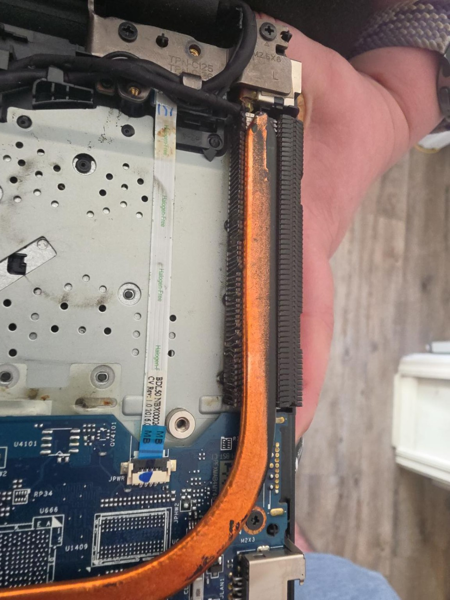
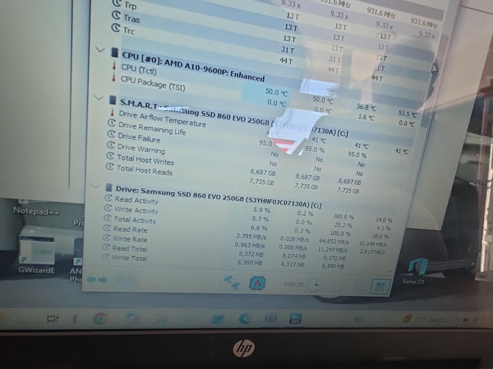
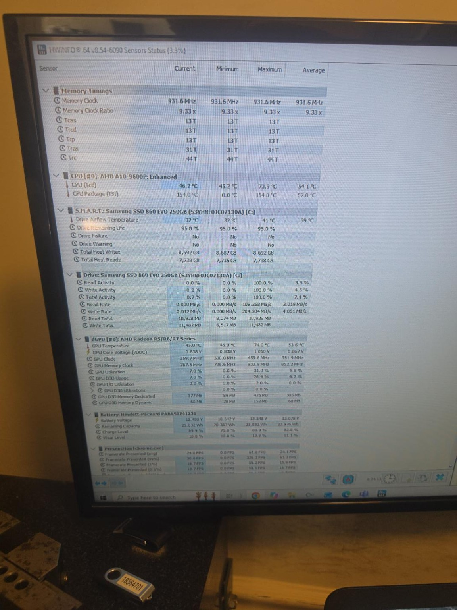

# HP Laptop Cooling System Repair
### Hardware Troubleshooting | Preventive Maintenance | Thermal Diagnostics

**Date:** October 27, 2026  
**Equipment:** HP 15 Series Laptop  
**Processor:** AMD A10-9600P  
**Operating System:** Windows  
**Role:** Hardware Troubleshooting and Repair

## Project Overview

I was assigned to repair an HP laptop used to operate precision measurement equipment for quality control in a manufacturing environment.

The laptop had a failed cooling fan and was taken out of service. My objective was to replace the faulty component, inspect the cooling system, and verify that the computer could operate at acceptable temperatures.

## Problem Identification

- CPU cooling fan had stopped functioning.
- Laptop was shut down to prevent overheating.
- Internal cooling assembly required inspection.
- Computer was needed for quality-control operations.

## Tools and Equipment

- Precision screwdriver set
- Replacement CPU cooling fan
- Flashlight
- HWiNFO hardware monitoring software
- Windows operating system

## Repair Procedure

### 1. Initial Inspection and Disassembly

Disconnected external power and removed the laptop battery.

Removed the chassis screws and carefully separated the housing to access the internal components.

### 2. Cooling Fan Removal

Located the CPU cooling fan and its electrical connector.

Disconnected and removed the defective fan.

### 3. Additional Cooling System Damage

During inspection, I discovered that several aluminum heatsink fins were severely bent and compressed.

This damage could restrict airflow and reduce cooling efficiency.

Carefully worked to straighten the damaged fins and improve airflow through the cooling assembly.

### 4. Replacement and Reassembly

Installed the replacement cooling fan, reconnected its electrical connector, and reassembled the laptop.

The system successfully powered on following the repair.

### 5. Thermal Diagnostics

Installed and launched HWiNFO to monitor operating temperatures.

Initial readings included:

| Component | Temperature |
|---|---|
| AMD A10-9600P CPU | 50.0°C |
| CPU recorded maximum | 56.8°C |
| Samsung SSD | 41°C |

During follow-up monitoring with YouTube running:

| Component | Current | Recorded Maximum |
|---|---|---|
| CPU (Tctl) | 46.2°C | 73.9°C |
| Integrated GPU | 45.0°C | 74.0°C |
| Samsung SSD | 32°C | 41°C |

## Results

- Successfully replaced the failed cooling fan.
- Identified previously unnoticed physical damage to the heatsink fins.
- Improved the condition of the cooling fins.
- Reassembled and successfully booted the laptop.
- Observed reasonable CPU temperatures during initial and follow-up monitoring.
- Confirmed the computer could run Windows and play YouTube video following the repair.

Further thermal testing and verification with the quality-control measurement equipment are recommended before considering the system fully validated for production.

## Skills Demonstrated

- Laptop hardware disassembly and reassembly
- Hardware fault identification
- Cooling system inspection and repair
- Component replacement
- Thermal monitoring with HWiNFO
- Troubleshooting and documentation
- Hardware maintenance in a manufacturing environment

## Lessons Learned

This repair reinforced the importance of inspecting surrounding components rather than replacing only the visibly failed part.

The damaged heatsink fins were discovered during disassembly and could have contributed to cooling problems even after replacing the fan.

Monitoring temperatures after the repair provided evidence that the cooling system was functioning under a light workload.

---

**Project Type:** Real-world IT hardware repair  
**Documentation:** Personal technical portfolio  
**Status:** Repair completed; production validation pending
